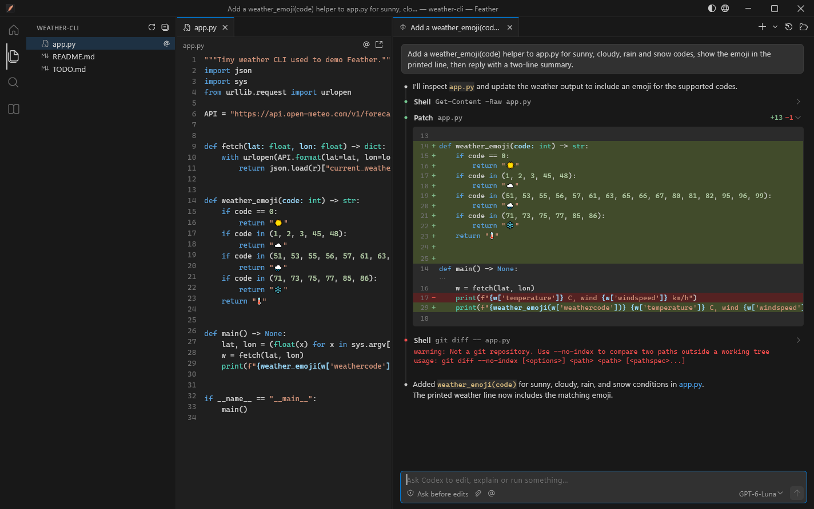
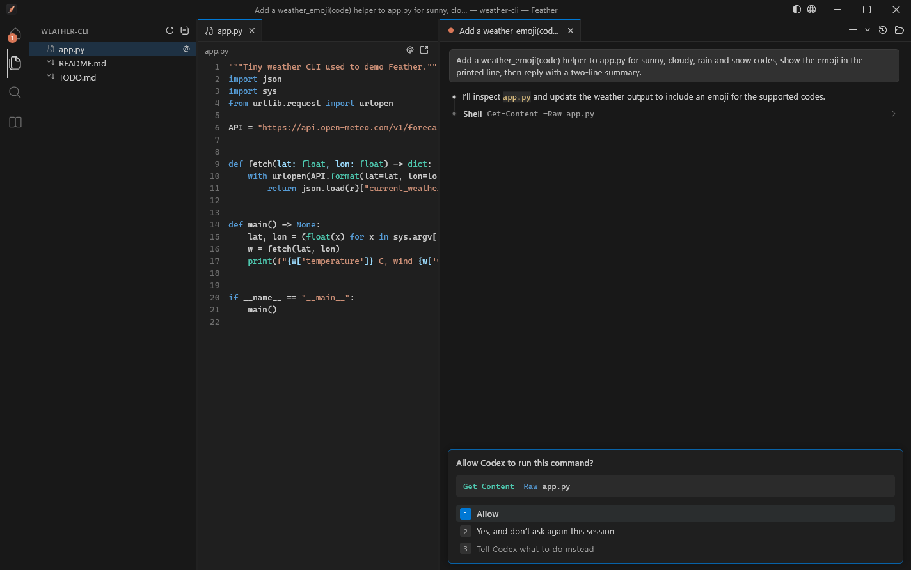
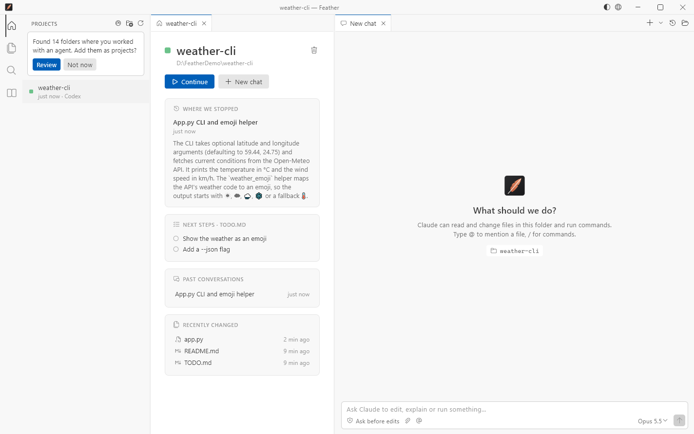

<p align="center">
  
</p>

<h1 align="center">Feather</h1>

<p align="center">
  <b>A lightweight native desktop app for Claude Code and Codex.</b><br>
  The chat you know from the VS Code panel, plus projects, files and memory —<br>
  in about <b>70 MB of RAM</b> instead of a whole editor.
</p>

<p align="center">
  <a href="../../releases/latest"><b>Download for Windows</b></a> ·
  <a href="README.ru.md">Читать по-русски</a>
</p>



## Why

Running Claude Code inside VS Code means running a whole Electron editor next to it. On a
machine with 8 GB of RAM that hurts: on the author's PC VS Code alone took **1.1 GB in 17
processes** before any work started.

Feather is a native window (Flutter, no browser engine inside) that talks to the official
command-line agents directly. The agents keep their own memory use; everything around them
gets much lighter.

| | Memory |
|---|---|
| VS Code with the Claude Code panel | ≈ 1.1 GB (editor) + the agent |
| **Feather** | **≈ 60–90 MB** (window) + the agent |

Feather also closes every agent process it started when you close it — even after a crash —
so nothing is left eating memory in the background.

## What you get

**The chat, like the VS Code panel**
- Streaming answers with Markdown, tables and highlighted code
- Tool calls as compact rows with inline diffs for edits and outputs for commands
- Permission cards: Allow · Allow for the session / always · tell the agent what to do instead
- Question cards with options, multi-select, “Other” and previews
- Plan mode with plan approval, permission modes (ask before edits, edit automatically, plan, auto)
- Model and effort picker, stop button, context usage
- Paste screenshots with Ctrl+V, attach files, `@` file mentions, `/` command menu
- Tabs for several conversations at once; past conversations with search and resume
  (a resumed tab starts the agent only when you send a message)

**Two agents in one window**
- **Claude Code** — uses your existing Claude login and subscription
- **Codex** — uses your ChatGPT login (`codex app-server`)
- Pick the agent per tab from the **+ ▾** menu

**Around the chat, like an editor**
- Explorer, file viewer with syntax highlighting (reloads when an agent edits the file),
  full-text search
- **Memory**: every `CLAUDE.md` and memory note Claude uses for the folder, Obsidian-style:
  `[[links]]`, backlinks, a graph of links, edit in place
- **Projects**: found automatically from your Claude and Codex history (you confirm what to
  add). Each project has a home page: where you stopped, next steps from `TODO.md` /
  `WORKLOG.md`, past conversations, recently changed files, git status, and a
  **Continue** button that resumes the latest conversation

**Made for real use**
- Reminder when an agent waits for you and you are not looking: a Windows notification that
  stays until dismissed (or Feather’s own reminder if notifications are off) and a flashing
  taskbar button
- Works with every keyboard layout (Ctrl+C/V/Z work on Russian, Greek, Hebrew… layouts)
- English and Russian UI; the language follows what you write to the agent
- Dark and light themes based on VS Code’s, VS Code icons (Codicons)





## Requirements

- Windows 10 or 11 (x64)
- [Claude Code](https://docs.claude.com/en/docs/claude-code) installed and signed in once
  in a terminal (`claude`), and/or the
  [Codex CLI](https://github.com/openai/codex) (or the ChatGPT extension for VS Code) signed
  in (`codex`)

Feather finds the agents itself (`~/.local/bin`, `PATH`, npm, or the binaries bundled with the
VS Code extensions). To point it somewhere else, set `FEATHER_CLAUDE_PATH` or
`FEATHER_CODEX_PATH`.

## Install

1. Download `Feather-windows-x64.zip` from [Releases](../../releases/latest).
2. Unzip anywhere and run `feather.exe`.

The build is not code-signed yet, so Windows SmartScreen may ask once: *More info → Run anyway*.

## Keyboard

| Keys | Action |
|---|---|
| Enter / Shift+Enter | Send / new line |
| Esc | Stop the agent |
| Shift+Tab | Next permission mode |
| ↑ (empty input) | Previous message |
| 1–9, ↑ ↓, Enter | Answer a permission or question card |
| Ctrl+T / Ctrl+W | New tab / close tab |
| Ctrl+Tab, Ctrl+1…9 | Switch tabs |
| Ctrl+H | Past conversations |
| Ctrl+O | Open a folder |
| Ctrl+B | Toggle the side bar |
| Ctrl+Shift+F | Search in files |

## Command line

```
feather.exe [folder] [--agent=claude|codex] [--model=<alias>] [--mode=default|acceptEdits|plan|auto] [--prompt=<text>] [--lang=en|ru]
```

## How it works

Feather does not call any model API itself and needs no API keys. It starts the official CLIs
and speaks the same protocols their IDE extensions use:

- Claude Code: `claude --input-format stream-json --output-format stream-json --permission-prompt-tool=stdio`
- Codex: `codex app-server` (JSON-RPC over stdio)

Everything stays on your machine; Feather sends nothing anywhere. Settings live in
`%APPDATA%\Feather`. Set `FEATHER_LOG=C:\path\feather.log` to record the protocol traffic
when reporting a bug.

## Build from source

Requires [Flutter](https://docs.flutter.dev/get-started/install/windows/desktop) 3.44+ with the
Windows desktop toolchain (Visual Studio Build Tools with C++).

```
flutter pub get
flutter build windows --release
```

The app is in `build\windows\x64\runner\Release`. `tools\shot.ps1` launches it and takes
screenshots for visual checks.

**Adding a language:** copy the English block in `lib/l10n.dart`, translate it and add it to
the `_all` map.

## Credits

- Icons: [Codicons](https://github.com/microsoft/vscode-codicons) by Microsoft, CC BY 4.0
- Built with [Flutter](https://flutter.dev) and the packages listed in `pubspec.yaml`;
  see [THIRD_PARTY_NOTICES.md](THIRD_PARTY_NOTICES.md)

Feather is an independent project. It is not affiliated with or endorsed by Anthropic or
OpenAI. Claude and Claude Code are trademarks of Anthropic; Codex and ChatGPT are trademarks
of OpenAI.

## License

[MIT](LICENSE)
