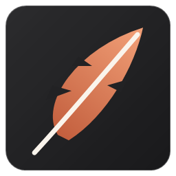
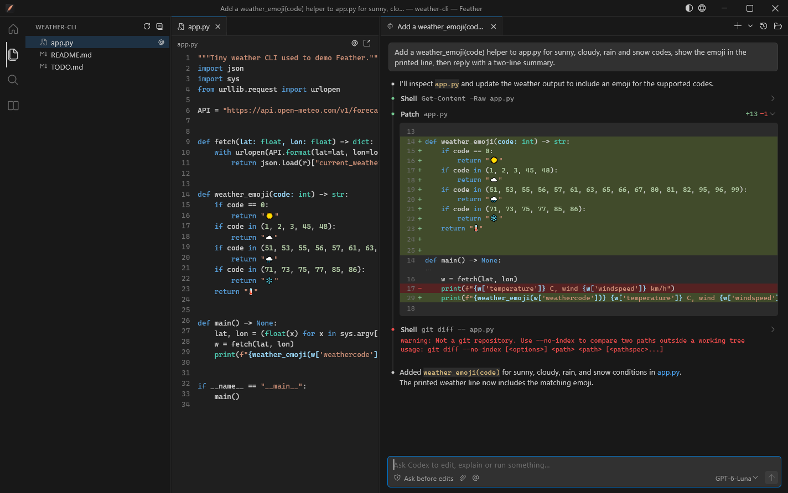
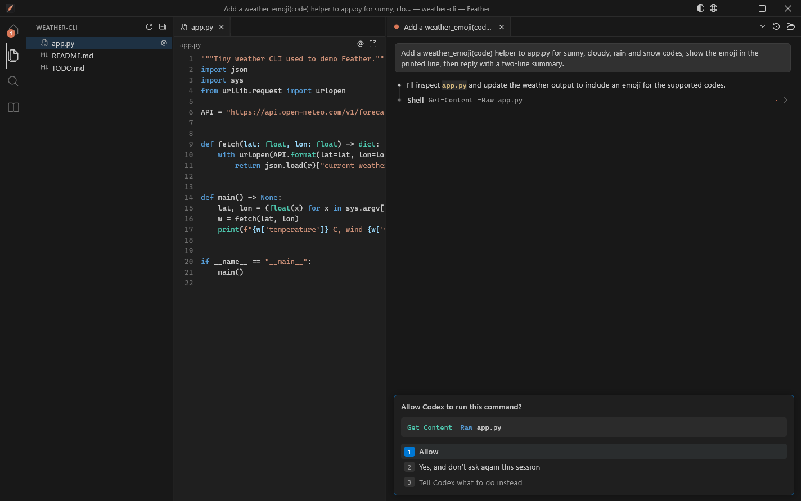
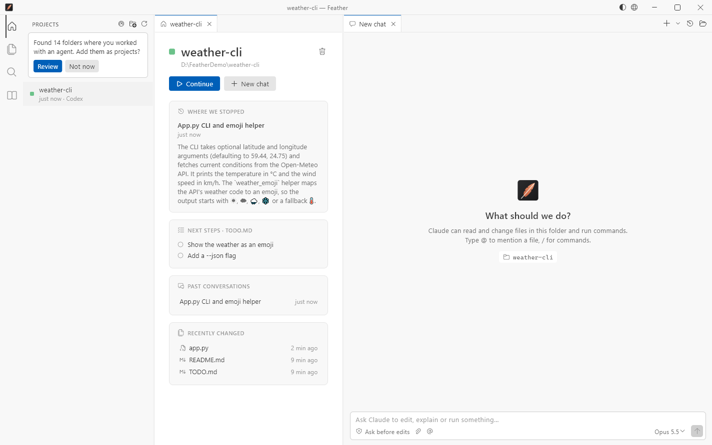

<p align="center">
  
</p>

<h1 align="center">Feather</h1>

<p align="center">
  <b>Лёгкая программа для Windows для работы с Claude Code и Codex.</b><br>
  Тот же чат, что в панели VS Code, плюс проекты, файлы и память,<br>
  и всё это примерно в <b>70 МБ памяти</b> вместо целого редактора.
</p>

<p align="center">
  <a href="../../releases/latest"><b>Скачать для Windows</b></a> ·
  <a href="README.md">English</a>
</p>



## Зачем

Чтобы пользоваться Claude Code в VS Code, рядом приходится держать открытым весь редактор на
Electron. На компьютере с 8 ГБ памяти это заметно: у автора один только VS Code занимал
**1,1 ГБ в 17 процессах**, ещё до начала работы.

Feather это обычное нативное окно (Flutter, без встроенного браузера), которое напрямую
общается с официальными консольными агентами. Сами агенты занимают столько же, сколько и
раньше, а всё вокруг них становится намного легче.

| | Память |
|---|---|
| VS Code с панелью Claude Code | около 1,1 ГБ (редактор) + агент |
| **Feather** | **около 60–90 МБ** (окно) + агент |

Когда Feather закрывается, он завершает все запущенные им процессы агентов, даже если
программа упала. Ничего не остаётся висеть в фоне.

## Что умеет

**Чат как в панели VS Code**
- Ответы появляются по ходу, с Markdown, таблицами и подсветкой кода
- Вызовы инструментов в компактных строках: правки видны как diff, у команд виден вывод
- Карточки разрешений: «Разрешить», «Разрешать в этой сессии» или «всегда», «Сказать агенту, что сделать вместо этого»
- Карточки вопросов с вариантами, множественным выбором, своим ответом и превью
- Режим плана с утверждением плана и режимы разрешений
- Выбор модели и усилия, кнопка остановки, заполненность контекста
- Вставка скриншотов через Ctrl+V, прикрепление файлов, упоминание файлов через `@`, меню команд через `/`
- Несколько разговоров во вкладках, прошлые разговоры с поиском и продолжением
  (у открытой из истории вкладки агент запускается, только когда вы напишете)

**Два агента в одном окне**
- **Claude Code** работает через ваш вход и подписку Claude
- **Codex** работает через вход ChatGPT (`codex app-server`)
- Агента для новой вкладки выбирают в меню **+ ▾**

**Вокруг чата всё как в редакторе**
- Проводник, просмотр файлов с подсветкой (обновляется, когда агент правит файл), поиск по тексту
- **Память**: все `CLAUDE.md` и записи памяти, которыми Claude пользуется в этой папке.
  Как в Obsidian: ссылки `[[…]]`, обратные ссылки, граф связей, правка на месте
- **Проекты** находятся сами по истории Claude и Codex, а добавляете их вы. У каждого проекта
  своя страница: где остановились, следующие шаги из `TODO.md` или `WORKLOG.md`, прошлые
  разговоры, недавно изменённые файлы, состояние git и кнопка **«Продолжить»**, которая
  открывает последний разговор

**Сделано для ежедневной работы**
- Напоминание, когда агент ждёт вашего ответа, а вы смотрите в другое окно: уведомление
  Windows, которое не пропадает само (или своё окошко, если уведомления выключены), и
  мигающая кнопка на панели задач
- Работает с любой раскладкой: Ctrl+C, Ctrl+V и Ctrl+Z срабатывают и на русской
- Интерфейс на русском и английском, язык подстраивается под то, как вы пишете агенту
- Тёмная и светлая темы по мотивам VS Code, иконки VS Code (Codicons)





## Что нужно

- Windows 10 или 11 (x64)
- Установленный [Claude Code](https://docs.claude.com/en/docs/claude-code), в который вы
  один раз вошли в терминале (`claude`), и/или [Codex CLI](https://github.com/openai/codex)
  (или расширение ChatGPT для VS Code), в который вы вошли (`codex`)

Feather сам находит агентов (`~/.local/bin`, `PATH`, npm или программы из расширений VS Code).
Если они лежат в другом месте, укажите путь в `FEATHER_CLAUDE_PATH` или `FEATHER_CODEX_PATH`.

## Установка

1. Скачайте `Feather-windows-x64.zip` со страницы [Releases](../../releases/latest).
2. Распакуйте в любую папку и запустите `feather.exe`.

Сборка пока не подписана, поэтому SmartScreen может один раз спросить: *Подробнее → Выполнить в любом случае*.

## Клавиши

| Клавиши | Действие |
|---|---|
| Enter / Shift+Enter | Отправить / новая строка |
| Esc | Остановить агента |
| Shift+Tab | Следующий режим разрешений |
| ↑ (пустое поле) | Предыдущее сообщение |
| 1–9, ↑ ↓, Enter | Ответить на карточку |
| Ctrl+T / Ctrl+W | Новая вкладка / закрыть вкладку |
| Ctrl+Tab, Ctrl+1…9 | Переключить вкладку |
| Ctrl+H | Прошлые разговоры |
| Ctrl+O | Открыть папку |
| Ctrl+B | Показать или скрыть боковую панель |
| Ctrl+Shift+F | Поиск по файлам |

## Как это устроено

Feather сам не обращается ни к каким моделям и не требует API-ключей. Он запускает официальные
консольные программы и общается с ними по тем же протоколам, что и их расширения для редакторов:

- Claude Code: `claude --input-format stream-json --output-format stream-json --permission-prompt-tool=stdio`
- Codex: `codex app-server` (JSON-RPC через stdio)

Всё остаётся на вашем компьютере, Feather никуда ничего не отправляет. Настройки хранятся в
`%APPDATA%\Feather`. Если нужно сообщить об ошибке, задайте `FEATHER_LOG=C:\путь\feather.log`,
и программа запишет обмен с агентом.

## Сборка из исходников

Нужен [Flutter](https://docs.flutter.dev/get-started/install/windows/desktop) 3.44 или новее с
инструментами для Windows (Visual Studio Build Tools с C++).

```
flutter pub get
flutter build windows --release
```

Готовая программа будет в `build\windows\x64\runner\Release`.

**Новый язык интерфейса:** скопируйте английский блок в `lib/l10n.dart`, переведите и добавьте
его в словарь `_all`.

## Благодарности

- Иконки: [Codicons](https://github.com/microsoft/vscode-codicons) от Microsoft, CC BY 4.0
- Сделано на [Flutter](https://flutter.dev) с пакетами из `pubspec.yaml`,
  подробности в [THIRD_PARTY_NOTICES.md](THIRD_PARTY_NOTICES.md)

Feather это независимый проект, не связанный с Anthropic и OpenAI и не одобренный ими.
Claude и Claude Code являются товарными знаками Anthropic, Codex и ChatGPT являются товарными
знаками OpenAI.

## Лицензия

[MIT](LICENSE)
